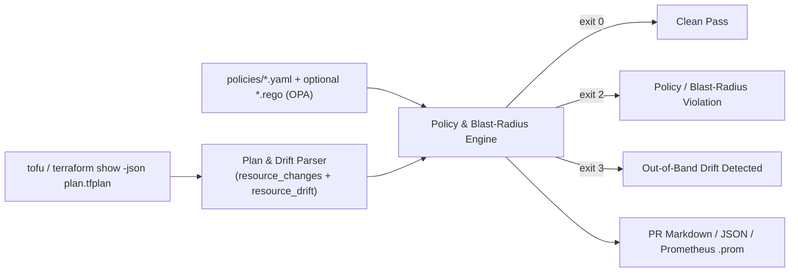

# Drift Gate

**Open-source IaC Drift Detection, Policy Gate, and Blast-Radius Guardrail** for OpenTofu and Terraform plans—delivering Spacelift/env0-style PR checks as a self-contained CLI, container, and GitHub Action with zero SaaS lock-in.

---

## Problem Statement

Infrastructure teams rely on `tofu plan` / `terraform plan`, yet raw plan logs bury out-of-band drift, overly permissive security rules, unencrypted databases, and accidental production deletions inside walls of text. `drift-gate` evaluates `show -json` plan artifacts deterministically using a built-in YAML/JSON rule engine (plus optional `opa` Rego evaluation) and returns crisp exit codes for CI/CD pipelines.

## Architecture



## Starter Policy Ruleset

| Rule ID | Severity | Protection |
| :--- | :--- | :--- |
| `no_public_storage` | `critical` | Blocks public S3 ACLs, disabled public access blocks, public GCS IAM, and public Azure Blob containers. |
| `no_open_admin_ingress` | `critical` | Blocks `0.0.0.0/0` or `::/0` ingress covering SSH (`22`) or RDP (`3389`). |
| `require_encrypted_databases` | `high` | Requires `storage_encrypted = true` on AWS RDS instances and clusters. |
| `protect_production_deletes` | `critical` | Blocks deleting/replacing production resources unless tag `drift_gate_override = "true"` is set. |
| `blast_radius_max_destroys` | `critical` | Gates plans destroying/replacing more than `--max-destroys` resources. |

## Quickstart

### 1. Install Locally

```bash
pip install -e ".[dev]"
```

### 2. Evaluate Sample Plans

```bash
# Clean plan -> exit 0
drift-gate evaluate --plan examples/plan_clean.json --policies policies --format markdown

# Policy violation plan -> exit 2
drift-gate evaluate --plan examples/plan_violation.json --policies policies --format terminal

# Out-of-band drift plan -> exit 3
drift-gate evaluate --plan examples/plan_drift.json --policies policies --format markdown
```

## CLI Reference

| Flag | Default | Description |
| :--- | :--- | :--- |
| `--plan`, `-p` | required | Path to `tofu show -json` / `terraform show -json` JSON file. |
| `--policies` | `policies` | Path to YAML/Rego policies directory or YAML file. |
| `--format`, `-f` | `terminal` | Output format: `terminal`, `json`, or `markdown`. |
| `--max-destroys` | `3` | Override blast-radius destroy/replace resource threshold. |
| `--out`, `-o` | unset | Write rendered report to file. |
| `--metrics-out` | unset | Write Prometheus gauge payload (`.prom`). |

## GitHub Action Usage

```yaml
- uses: your-org/drift-gate@v0.1.0
  with:
    plan: tfplan.json
    policies: ./policies
    max_destroys: "3"
```

## Docker Usage

```bash
docker build -t drift-gate:local .
docker run --rm drift-gate:local evaluate --plan examples/plan_clean.json --policies policies --format markdown
```

## Running Tests

```bash
pytest -v
```

## License

Apache License 2.0 — see [LICENSE](LICENSE).
